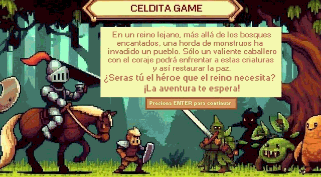

# Celdita Game

Celdita es un juego 2D hecho en Wollok Game: Tomás, un caballero, tiene que derrotar a 20 monstruos en un bosque con la ayuda de una espada y algunas pociones. Lo hicimos en equipo de tres personas entre mayo y junio de 2024, como trabajo práctico de Algoritmos I en la Tecnicatura en Programación Informática de la UNSAM.

## Problema que resuelve

El trabajo práctico era armar un juego con Wollok Game, la librería de Wollok para juegos en grilla. Wollok Game da lo básico (una grilla, eventos de teclado, colisiones y temporizadores) y todo lo demás hay que modelarlo con objetos.

Los puntos difíciles:

- Saber qué hay al lado de Tomás. Wollok solo avisa una colisión cuando dos objetos están en la misma celda, pero para pelear hace falta saber qué hay en la celda de al lado.
- Manejar muchos objetos distintos en el mismo tablero. Monstruos, pociones, la espada, el puntaje y el fondo comparten la grilla y reciben los mismos eventos. El código que maneja las colisiones no debería tener que preguntar qué es cada cosa.
- Coordinar varias cosas que pasan al mismo tiempo. Aparece un monstruo por segundo, cada monstruo se mueve cada dos segundos y los efectos de las pociones duran cinco segundos y se tienen que deshacer solos.
- Manejar los sonidos. En Wollok un sonido se puede reproducir una sola vez, así que la música no se puede volver a arrancar cuando reintentás la partida.

## Demo



Una partida completa, del menú a la pantalla de victoria. La parte del juego está acelerada al doble. La grabé con un bot que juega solo: detecta los sprites en la pantalla y le manda las teclas al juego.

## Tecnologías

- **Wollok 3.0.0**, un lenguaje orientado a objetos pensado para enseñar programación, con su IDE basado en Eclipse.
- **Wollok Game**, la librería de Wollok para juegos en grilla.

## Cómo funciona

El programa `celditaGame.wpgm` arranca el juego y `celdita.wlk` maneja el paso entre pantallas: menú, explicación, partida y pantalla final (ganaste o perdiste). Al empezar la partida, una estatua le habla a Tomás y a los diez segundos se convierte en una espada que suma 10 de poder. Mientras tanto, a los siete segundos empieza el combate: desde ahí, cada segundo aparece un monstruo de uno de estos tres tipos:

| Monstruo | Vida | Daño | Poción que puede soltar |
|---|---|---|---|
| Sombrío | 50 | 40 | Invencibilidad: vida al máximo y no recibe daño por 5 segundos |
| Slime | 60 | 20 | Fuerza: duplica el poder de ataque por 5 segundos |
| Esqueleto | 80 | 10 | Aturdimiento: frena a los monstruos que están en el mapa |

Cuando un monstruo muere, suelta su poción con un 50 % de probabilidad. La poción queda tres segundos en el piso, Tomás la guarda en una mochila de tres lugares y la usa con P. Ganás al llegar a 20 monstruos derrotados.

Para resolver lo de "qué hay al lado", Tomás lleva pegadas cuatro celdas invisibles: arriba, abajo, izquierda y derecha. Cuando un monstruo pisa una de esas celdas, se frena y empieza a atacar. Cuando Tomás ataca con una flecha, le pega a lo que haya en la celda de ese lado.

El código está en `src/`:

- `celdita.wlk`: pantallas, fin de partida y reinicio.
- `configuraciones.wlk`: teclas y colisiones.
- `combate.wlk`: música de batalla y aparición de monstruos.
- `tomas.wlk`, `monstruos.wlk` y `pocion.wlk`: el personaje, los enemigos y las pociones.
- `extra.wlk`: las celdas invisibles, la espada, el puntaje y dos ayudas chicas (números al azar y límites del tablero).
- `visuales.wlk` y `sonidos.wlk`: pantallas, corazones de vida y sonidos.

Las decisiones que tomé y por qué:

- **Todo lo que puede estar en el tablero entiende los mismos mensajes** (`esEncontrado` cuando Tomás lo pisa, `recibirDanio` cuando le pegan). Así el código de colisiones manda el mensaje sin preguntar de qué tipo es el objeto y cada uno responde a su manera: la poción se guarda en la mochila, la espada suma poder y el fondo no hace nada.
- **Las pociones son una clase con un método `activar` que cada tipo define.** Los efectos temporales los programé con `game.schedule`, que los deshace a los cinco segundos. Sumar una poción nueva es sumar una clase.
- **El monstruo le pega a la posición donde estaba Tomás cuando se le acercó, medio segundo después.** Si Tomás se mueve a tiempo, esquiva el golpe. Además el golpe solo cuenta si en esa celda está Tomás.
- **Las músicas quedan guardadas y los efectos de sonido se crean cada vez.** Como un sonido se reproduce una sola vez, la música de batalla se pausa al perder y se retoma al reintentar, mientras que cada paso o golpe crea un sonido nuevo.

## Cómo correrlo

Necesitás el IDE de [Wollok 3.0.0](https://github.com/uqbar-project/wollok/releases/tag/v3.0.0) y Java 11, que es la versión con la que lo probé. El juego no corre en Wollok TS (la versión actual de Wollok) porque usa `game.addVisualIn`, que ahí ya no existe.

1. Cloná el repositorio:

   ```bash
   git clone https://github.com/solalcaraz/celdita-game.git
   ```

2. Abrí Wollok e importá la carpeta `celdita-game` como proyecto existente de Eclipse.
3. Abrí `src/celditaGame.wpgm` y ejecutalo como programa Wollok.

Controles:

| Tecla | Acción |
|---|---|
| Enter | Avanzar en el menú y la explicación, reintentar después de perder, salir después de ganar |
| W A S D | Mover a Tomás |
| Flechas | Atacar hacia ese lado |
| P | Usar la primera poción de la mochila |
| Backspace | Salir después de perder (la pantalla dice DEL, pero la tecla configurada es Backspace) |

## Qué aprendí y qué mejoraría

**Qué aprendí**

Puse en práctica los conceptos de programación con objetos: clases, herencia, métodos abstractos y objetos que se comunican entre sí. Lo que más me quedó es el polimorfismo en serio, con muchos objetos distintos que responden a los mismos mensajes y un código de colisiones que no necesita saber con quién está hablando. También aprendí a manejar el tiempo en un juego: coordinar con `onTick` y `schedule` cosas que pasan a la vez, como monstruos que se mueven, pociones que se vencen y la estatua que habla mientras empieza la partida.

**Qué mejoraría**

Al preparar este repo encontré varios bugs de la versión entregada. Los dejé como estaban para no cambiar el juego:

- Todos los monstruos registran su movimiento con el mismo nombre (`"movimiento"`). Cuando uno se frena para atacar, `removeTickEvent` saca un evento con ese nombre, que puede ser el de otro monstruo. Por eso algunos monstruos quedan quietos para siempre. Cada monstruo debería usar un nombre propio.
- Para elegir qué monstruo aparece, el código tira un número al azar distinto en cada `if`. A veces no aparece ninguno y los tres tipos no salen con la misma probabilidad.
- Tomás y los monstruos usan `game.uniqueCollider`, que falla cuando hay dos objetos en la misma celda, y el juego muestra el error "Illegal operation 'uniqueElement'" en pantalla.
- Al reintentar, Tomás aparece en la celda (0, 0), donde también está el fondo. Los monstruos le mandan el golpe al fondo y el juego tira "fondo no entiende el mensaje esAtacado".
- El esqueleto compara su posición horizontal con la de Tomás, pero se mueve en vertical.
- El único test falla porque intenta sacar del tablero una espada que nunca se agregó. Faltan tests con verificaciones reales.
- Migrarlo a Wollok TS permitiría jugarlo en el navegador.

## Autoría y mejoras

Este repositorio es la versión pública del trabajo práctico que hicimos en equipo entre mayo y junio de 2024. El repositorio original es privado. El tag [`tp-original-2024`](https://github.com/solalcaraz/celdita-game/tree/tp-original-2024) marca el TP tal como lo entregamos.

**Equipo:** María Sol Alcaraz, Damián Palomba y Santiago Zolla.

**Mi parte en la versión original**:

- Armé la base del juego a partir de mi repositorio personal: Tomás, los monstruos, las pociones y la espada.
- Hice el sistema de pociones y la mochila.
- Sumé los sonidos y las imágenes, y separé el código en `combate`, `configuraciones`, `sonidos` y `visuales`.
- Integré los cambios de Santiago.
- Hice los ajustes finales: la música se pausa y se retoma al reintentar, los monstruos le pegan solo a Tomás y la espada vuelve a su estado inicial en cada partida.

**Lo que hice después**:

- Saqué el código muerto: métodos y propiedades sin uso, imports que sobraban, código comentado y los mocks de sonido del test que no estaban conectados al juego.
- Junté en `extra.wlk` la lógica repetida: los números al azar (`azar.entero`) y los límites del tablero (`tablero.contiene`).
- Hice que Tomás y la espada se reinicien solos con `reiniciar()`, en lugar de que la pantalla de fin les cambie cada atributo desde afuera.
- Renombré lo que no se entendía (`valorRan`, `validacion`, `checkGanar`, `imagen.agregar`) y pasé a singular las clases `Monstruos`, `Pociones` y `Visuales`.
- Dejé solo los comentarios que explican el porqué, como las limitaciones de Wollok con los sonidos y con `removeTickEvent`.
- Grabé la demo con un bot que juega solo.
- Reescribí este README.

Para verificar que el comportamiento no cambió, corrí la versión entregada y la pulida con Wollok 3.0.0 y el mismo bot: en las dos el bot gana la partida, después de perder el reinicio funciona igual, el test da el mismo resultado y aparecen los mismos errores de `uniqueElement`.
