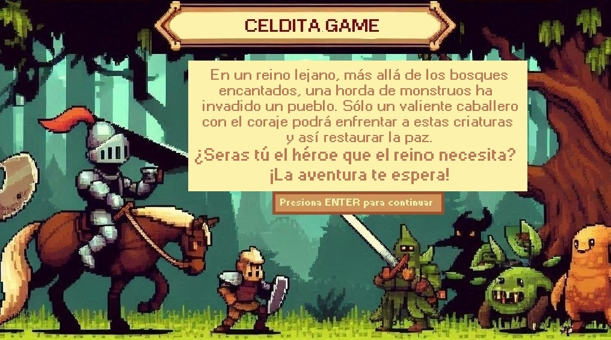
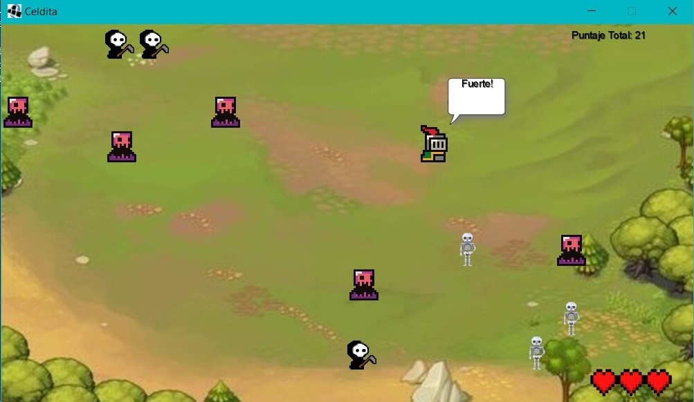

# Celdita Game

## Equipo de desarrollo

- Alcaraz, Maria Sol
- Palomba, Damian
- Zolla, Santiago

## Capturas

## Reglas de Juego / Instrucciones

- Para moverte deberas usar: WASD
- Para atacar los monstruos tendras que posicionarte al lado del mismo y usar: FLECHAS
- Solo podras llevar 3 pociones en tu mochila y para activarlas usar: P

## Otros

- Materia: Algoritmos I - UNSAM
- Versión de wollok
- Una vez terminado, no tenemos problemas en que el repositorio sea público
